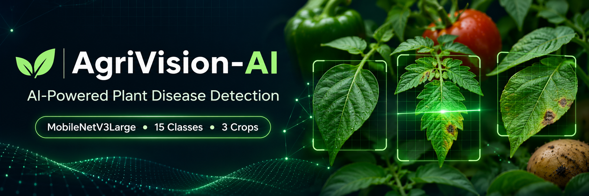
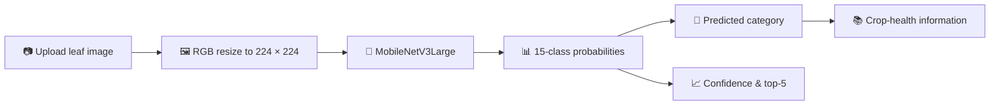

<p align="center">
  
</p>

# 🌿 AgriVision-AI
### AI-Powered Plant Leaf Disease Detection & Intelligent Crop Health Assistance

**Upload a leaf. Explore its health. Discover actionable crop-care information.**

[](https://agrivisionaa.streamlit.app/)
[](https://www.python.org/)
[](https://www.tensorflow.org/)
[](https://streamlit.io/)

**[🚀 Try Live App](https://agrivisionaa.streamlit.app/)** · **[✨ Features](#-features)** · **[📊 Results](#-model-performance)** · **[⚙️ Run Locally](#️-run-locally)**

</div>

---

## 🌱 Overview

**AgriVision-AI** is a deep-learning-powered plant leaf screening application built with **MobileNetV3Large**, **TensorFlow**, and **Streamlit**. Upload an image of a **bell pepper, potato, or tomato** leaf to receive a predicted disease/healthy category, model confidence, alternative predictions, and supporting crop-health information.

> [!IMPORTANT]
> Predictions are AI-assisted screening results, not a laboratory diagnosis. Consult a qualified agricultural professional before making important crop-treatment decisions.

## ✨ Features

| Feature | What it does |
|:--|:--|
| 📸 **Drag-and-drop upload** | Upload a leaf image through the browser. |
| 🧠 **MobileNetV3Large inference** | Classifies images into 15 supported leaf-health categories. |
| 🌿 **Healthy / disease indication** | Displays a quick predicted health status. |
| 📊 **Confidence & top predictions** | Shows model confidence and alternative class scores. |
| 📚 **Crop-health knowledge base** | Offers disease information to support further investigation. |
| 🌐 **Hosted demo** | Try the app without installing Python or downloading the model. |
| 🎨 **Dark interface** | Clean, responsive Streamlit experience. |

<div align="center">

### ⚡ Launch the interactive demo

**[🌿 OPEN AGRIVISION-AI →](https://agrivisionaa.streamlit.app/)**

</div>

## 📸 How It Works



1. **Open** the [live application](https://agrivisionaa.streamlit.app/).
2. **Upload** a clear image of a tomato, potato, or bell pepper leaf.
3. **Review** the predicted class and confidence score.
4. **Explore** other likely classes and the accompanying disease information.

## 🍅 Supported Crops & Categories

<details>
<summary><strong>🍅 Tomato — 10 categories (click to expand)</strong></summary>

- Bacterial spot
- Early blight
- Late blight
- Leaf mold
- Septoria leaf spot
- Spider mites (two-spotted spider mite)
- Target spot
- Tomato yellow leaf curl virus
- Tomato mosaic virus
- Healthy

</details>

<details>
<summary><strong>🥔 Potato — 3 categories (click to expand)</strong></summary>

- Early blight
- Late blight
- Healthy

</details>

<details>
<summary><strong>🫑 Bell Pepper — 2 categories (click to expand)</strong></summary>

- Bacterial spot
- Healthy

</details>

## 📊 Model Performance

Results from the project's held-out test evaluation:

| Metric | Result |
|:--|--:|
| **Test accuracy** | **95.22%** |
| **Macro F1-score** | **0.9504** |
| **Test images** | **3,094** |
| **Unique dataset images** | **20,624** |
| **Classes** | **15** |
| **Architecture** | **MobileNetV3Large** |
| **Input resolution** | **224 × 224 RGB** |

> [!NOTE]
> These figures describe performance on the project's PlantVillage test split. Real-world results can differ because of lighting, backgrounds, camera quality, and unfamiliar diseases.

## 🧰 Tech Stack

- **Deep learning:** TensorFlow / Keras, MobileNetV3Large
- **Application:** Streamlit
- **Image processing:** Pillow, NumPy
- **Data handling:** pandas
- **Dataset:** PlantVillage (selected tomato, potato, and bell pepper classes)
- **Deployment:** Streamlit Community Cloud

## 🗂️ Project Structure

```text
AgriVision-AI/
├── app/
│   ├── app.py                         # Streamlit application (deployment entrypoint)
│   └── knowledge_base/
│       └── disease_information.json   # Crop-health information
├── deployment/
│   ├── class_names.json
│   ├── model_metadata.json
│   └── mobilenetv3large_inference_savedmodel/
│       ├── saved_model.pb
│       └── variables/
├── assets/
│   └── banner.png                     # README banner (add this folder)
├── requirements.txt
└── README.md
```

> This repository may also contain earlier experiments, notebooks, scripts, and a legacy root-level `app.py`. **The live Streamlit entrypoint is `app/app.py`.**

## ⚙️ Run Locally

**Prerequisite:** Python **3.11** and Git.

```bash
git clone https://github.com/Abhish0030/AgriVision-AI.git
cd AgriVision-AI
python -m venv .venv
```

Activate the virtual environment:

```bash
# Windows PowerShell
.venv\Scripts\Activate.ps1

# macOS / Linux
source .venv/bin/activate
```

Install dependencies and start the app:

```bash
pip install -r requirements.txt
streamlit run app/app.py
```

Open the local address printed by Streamlit (typically `http://localhost:8501`).

> [!TIP]
> The deployed model uses TensorFlow SavedModel inference. Its model files and metadata must remain inside `deployment/` as shown above. The app expects RGB input at 224 × 224; **do not manually divide pixel values by 255**, since MobileNetV3 includes its own preprocessing.

## ☁️ Deploy Your Own Copy

1. Fork the repository.
2. Visit [Streamlit Community Cloud](https://share.streamlit.io/).
3. Choose the fork, branch `main`, and **main file path `app/app.py`**.
4. Select **Python 3.11** in advanced settings.
5. Deploy and test a real leaf upload.

## 🔭 Future Improvements

- 🌍 Evaluate on more real-field leaf photos.
- 🪴 Extend beyond the current three crops.
- 📱 Improve mobile-first usability and accessibility.
- 🧪 Add uncertainty handling for unsupported plants and ambiguous images.
- 🌐 Explore multilingual crop-health guidance.

## 🤝 Contributing

Issues and pull requests are welcome. Please include reproduction steps for bugs and avoid uploading sensitive data or proprietary imagery.

## 🙌 Acknowledgments

- **PlantVillage** dataset and its contributors.
- **TensorFlow / Keras** for the deep learning ecosystem.
- **Streamlit** for the web app framework.

---

<div align="center">

### 🌿 Helping make plant-health screening more accessible

**[🚀 Launch AgriVision-AI](https://agrivisionaa.streamlit.app/)** · **[⬆ Back to top](#-agrivision-ai)**

<sub>Built for educational and research demonstration purposes.</sub>

</div>
